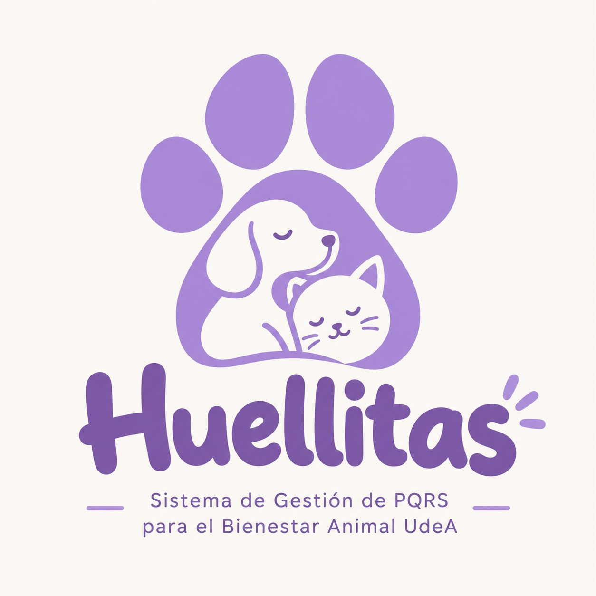

# Huellitas🐾🐶🐱
### Sistema de gestión de PQRS para el bienestar animal UdeA

## 1. - 2. Integrantes👯👯
### • Laura Valentina Forero Rojas
Soy estudiante de Ingeniería Industrial con interés por la organización de procesos, el análisis de información y el desarrollo de soluciones que mejoren la gestión administrativa. Me destaco por ser responsable, creativa y metódica al documentar proyectos, elaborar informes y estructurar el trabajo en equipo. Dentro del desarrollo de "Huellitas" puedo aportar en la planificación del proyecto y la documentación en GitHub.

### • Isabela Naranjo Gómez
Soy estudiante de Ingeniería Industrial y me interesa aprender sobre diferentes áreas de la carrera y adquirir nuevos conocimientos. Me considero una persona responsable, perfeccionista y analítica, por lo que me gusta trabajar con detalle, revisar la información y comprender bien cada actividad antes de realizarla. También tengo una actitud de aprendizaje constante y un alto compromiso con los proyectos en los que participo. Dentro del desarrollo de "Huellitas", puedo aportar principalmente en el manejo y organización de los datos, la gestión de los archivos del programa y la revisión detallada de la información.

### • Luciana Mejía Cardona
Soy estudiante de Ingeniería Industrial y me interesan especialmente temas como la automatización, el manejo del personal, el control de calidad y la producción. Me considero una persona paciente, curiosa, sociable y alegre. También me gusta hacer las cosas de la mejor manera posible, por lo que suelo ser muy detallista y cuidadosa al momento de revisar mi trabajo. Dentro de un equipo me gusta proponer ideas y buscar nuevas perspectivas, pero también escuchar las opiniones de los demás y apoyar la opción que mejor contribuya al objetivo del proyecto. Para la realización de nuestro proyecto "Huellitas", puedo aportar principalmente en el diseño, el manejo de datos y la programación, además de la revisión de errores, la organización de estructuras y la elaboración de presentaciones.

### • Juliana Silva Moreno
Soy estudiante de Ingeniería Industrial, con interés por aprender y desarrollar conocimientos en diferentes áreas de la carrera. Me caracterizo por ser una persona creativa, comprometida y con iniciativa, a quien le gusta proponer ideas, buscar soluciones y cuidar los detalles en los proyectos que realiza. También considero importante el trabajo en equipo y la comunicación para lograr buenos resultados. Dentro del desarrollo de "Huellitas", puedo aportar principalmente en la generación de ideas, la organización y planificación del proyecto, el análisis de información y la elaboración de propuestas que contribuyan al desarrollo del programa.

## 3. Huellitas🐾🐾

Huellitas es un sistema de gestión de PQRS diseñado para registrar y administrar las solicitudes relacionadas con el bienestar de perros y gatos de la Universidad de Antioquia. El software permitirá almacenar la información de cada caso en archivos planos independientes, generar radicados consecutivos, consultar el estado de las solicitudes y obtener estadísticas que apoyen la gestión del programa de bienestar animal. Su desarrollo se realizará completamente en Python mediante una aplicación de consola intuitiva y fácil de utilizar.

## 4. Licencia del software🧑‍💻🪪

Huellitas ©️ 2026 es un proyecto académico desarrollado por Laura Valentina Forero Rojas, Isabela Naranjo Gómez, Luciana Mejía Cardona y Juliana Silva Moreno.

Este proyecto está licenciado bajo la *Creative Commons Atribución–NoComercial–SinDerivadas 4.0 Internacional (CC BY-NC-ND 4.0)*.

Esto significa que el proyecto puede compartirse siempre que se reconozca la autoría, no se utilice con fines comerciales y no se distribuyan versiones modificadas.

>* <a href="https://github.com/isabelanaranjo-code/Trabajo-final">Huellitas</a> ©️ 2026 by <a href="https://github.com/isabelanaranjo-code/Trabajo-final">Laura Valentina Forero Rojas, Isabela Naranjo Gómez, Luciana Mejía Cardona, Juliana Silva Moreno</a> is licensed under <a href="https://creativecommons.org/licenses/by-nc-nd/4.0/">CC BY-NC-ND 4.0</a>

## 5. Reporte de visión🗒️🖋️
### Visión

Desarrollar un software confiable y organizado que facilite la gestión de las PQRS relacionadas con el bienestar de perros y gatos de la Universidad de Antioquia, permitiendo registrar, consultar y realizar seguimiento a cada solicitud de manera eficiente y estructurada.

### Objetivo general

Crear un programa en Python que permita registrar, consultar y administrar documentos PQRS mediante archivos planos, garantizando radicados consecutivos, validación de datos y una gestión organizada de la información.

### Objetivos específicos

- Registrar peticiones, quejas, reclamos y sugerencias.
- Validar la información ingresada por el usuario.
- Generar radicados únicos y consecutivos.
- Consultar el estado de las solicitudes registradas.
- Obtener estadísticas relevantes para apoyar la toma de decisiones.

### Beneficios del software

- Organiza la información de forma estructurada.
- Reduce errores en el registro manual.
- Facilita el seguimiento de cada PQRS.
- Genera estadísticas útiles para la gestión del bienestar animal.
- Mantiene la información separada según el tipo de solicitud.
## 6. Especificación de requisitos🔐📑

### 6.1. Requisitos funcionales

Los requisitos funcionales describen las acciones y los servicios que deberá realizar el sistema Huellitas para gestionar las peticiones, quejas, reclamos y sugerencias relacionadas con el bienestar animal en la Universidad de Antioquia.

| Código | Requisito funcional | Descripción |
| :--- | :--- | :--- |
| *RF-01* | Registro de PQRS | El sistema permitirá registrar peticiones, quejas, reclamos y sugerencias mediante opciones independientes en el menú principal. |
| *RF-02* | Generación de radicado | El sistema asignará automáticamente un número de radicado único y consecutivo a cada solicitud registrada, con el propósito de facilitar su identificación y seguimiento. |
| *RF-03* | Validación de información | El sistema verificará que los campos obligatorios estén completos y que los datos ingresados cumplan con los formatos establecidos antes de guardar una solicitud. |
| *RF-04* | Clasificación de solicitudes | El sistema identificará y almacenará cada solicitud según su categoría: petición, queja, reclamo o sugerencia. |
| *RF-05* | Almacenamiento de información | El sistema guardará la información de las solicitudes en archivos de texto plano, permitiendo conservar los registros y consultarlos posteriormente. |
| *RF-06* | Consulta de solicitudes | El sistema permitirá consultar una solicitud mediante su número de radicado y mostrará la información registrada, incluyendo su tipo, fecha y estado. |
| *RF-07* | Generación de comprobantes | El sistema permitirá generar un comprobante en formato de texto con los datos principales de la solicitud y su número de radicado. |
| *RF-08* | Seguimiento de solicitudes | El sistema permitirá identificar el estado de cada solicitud, utilizando categorías como registrada, en proceso y solucionada. |
| *RF-09* | Control de tiempos de respuesta | El sistema tendrá en cuenta un plazo máximo de 30 días calendario para el seguimiento y la respuesta de las solicitudes, de acuerdo con los parámetros establecidos para el proyecto. |
| *RF-10* | Generación de estadísticas | El sistema permitirá consultar estadísticas generales sobre las solicitudes registradas, como cantidad por categoría, estado, porcentaje de solicitudes solucionadas y tiempo promedio de respuesta. |

### 6.2. Requisitos no funcionales

Los requisitos no funcionales establecen las condiciones de funcionamiento, calidad y características técnicas que deberá cumplir el sistema Huellitas.

| Código | Requisito no funcional | Descripción |
| :--- | :--- | :--- |
| *RNF-01* | Plataforma de desarrollo | El sistema deberá desarrollarse en el lenguaje de programación Python y funcionar mediante una interfaz de consola. |
| *RNF-02* | Facilidad de uso | El menú deberá presentar opciones claras, organizadas y comprensibles para facilitar la interacción de los usuarios. |
| *RNF-03* | Persistencia de la información | La información registrada deberá conservarse en archivos de texto plano, evitando que los datos se pierdan al cerrar el programa. |
| *RNF-04* | Integridad de los datos | El sistema deberá garantizar que los números de radicado sean únicos y que la información almacenada mantenga una estructura organizada. |
| *RNF-05* | Rendimiento | El sistema deberá ejecutar las operaciones de registro, consulta y generación de estadísticas en tiempos adecuados para el volumen de información esperado. |
| *RNF-06* | Mantenibilidad | El código deberá organizarse en módulos y funciones que faciliten su comprensión, revisión, corrección y actualización. |
| *RNF-07* | Manejo de errores | El sistema deberá controlar entradas incorrectas y mostrar mensajes que orienten al usuario para continuar utilizando el programa. |

## 7. Plan de proyecto y presupuesto💸💰⌛

### 7.1. Corrección de roles y responsabilidades

La distribución de roles y responsabilidades se establece teniendo en cuenta las habilidades, los aportes y las actividades que desarrollará cada integrante durante las diferentes etapas del proyecto. Aunque cada integrante tendrá responsabilidades principales, algunas actividades se realizarán de manera conjunta para garantizar la integración y el cumplimiento de los objetivos.

| Integrante | Rol asignado | Responsabilidades específicas | Actividades y entregables |
| :--- | :--- | :--- | :--- |
| *Laura Valentina Forero Rojas* | Coordinación, planeación y documentación | Organizar las actividades del equipo, apoyar la distribución de tareas, realizar seguimiento al cumplimiento del cronograma y consolidar la información correspondiente a la documentación del proyecto. | Organización del trabajo, actualización del README, elaboración y revisión de la documentación y consolidación de los avances. |
| *Laura Valentina Forero Rojas* | Diseño visual y presentación | Apoyar la construcción de la identidad visual del proyecto y organizar los elementos gráficos y de presentación que permitan identificar a Huellitas. | Diseño del logo, selección de elementos visuales y apoyo en la presentación del proyecto. |
| *Isabela Naranjo Gómez* | Gestión y organización de datos | Participar en la identificación de los datos necesarios para el registro de las solicitudes, definir la información que deberá almacenarse y apoyar la organización de los archivos del sistema. | Identificación de campos, organización de los registros y apoyo en la estructura de almacenamiento de la información. |
| *Isabela Naranjo Gómez* | Validación y revisión | Revisar que la información ingresada cumpla con las condiciones establecidas, identificar posibles inconsistencias y apoyar las pruebas del funcionamiento del sistema. | Revisión de datos, validación de registros, identificación de errores y verificación de resultados. |
| *Luciana Mejía Cardona* | Diseño y programación del sistema | Participar en el diseño de la solución informática y en el desarrollo de las funcionalidades principales mediante Python, procurando que el programa responda a los requisitos definidos. | Diseño de la estructura del programa, desarrollo de funcionalidades y elaboración de componentes del sistema. |
| *Luciana Mejía Cardona* | Estructuras de programación y revisión | Apoyar la organización del código mediante funciones, estructuras de control y manejo de datos, además de revisar el funcionamiento de los componentes desarrollados. | Implementación de estructuras de programación, revisión del código y apoyo en la corrección de errores. |
| *Juliana Silva Moreno* | Análisis de la problemática y requisitos | Participar en el análisis de las necesidades relacionadas con la gestión de PQRS de bienestar animal, identificar los problemas que busca solucionar el proyecto y proponer alternativas de mejora. | Análisis de la problemática, identificación de necesidades, formulación de requisitos y propuestas para el funcionamiento del sistema. |
| *Juliana Silva Moreno* | Organización y planificación | Apoyar la definición de las actividades necesarias para desarrollar el proyecto, organizar las ideas del equipo y contribuir al seguimiento de los objetivos y tiempos establecidos. | Organización de actividades, apoyo en el cronograma y seguimiento de los avances del proyecto. |
| *Todo el equipo* | Integración y pruebas | Trabajar conjuntamente en la integración de los componentes del programa, comprobar que las funcionalidades se relacionen correctamente y detectar errores durante su ejecución. | Integración de módulos, ejecución de pruebas, identificación de fallas y aplicación de correcciones. |
| *Todo el equipo* | Revisión y entrega final | Verificar que el proyecto cumpla con los requisitos establecidos, revisar la documentación y preparar los elementos necesarios para la presentación y entrega académica. | Revisión general, ajustes finales, organización de archivos y preparación de la sustentación. |

### 7.2. Corrección del cronograma de actividades – Diagrama de Gantt

El cronograma contempla un periodo de 16 semanas, correspondiente a la duración del semestre académico. Durante este tiempo se desarrollarán las diferentes etapas del proyecto, desde la identificación de la problemática y la definición de los requisitos hasta la programación, integración, pruebas y entrega final.

| N.º | Actividad | Descripción | Responsable(s) | Periodo |
| :---: | :--- | :--- | :--- | :--- |
| *1* | Conformación del equipo y selección del proyecto | Definir los integrantes, seleccionar la problemática y establecer la idea general de solución. | Todo el equipo | Semana 1 |
| *2* | Análisis de la problemática | Identificar las necesidades relacionadas con la atención de PQRS sobre bienestar animal en la Universidad de Antioquia. | Todo el equipo | Semanas 1 y 2 |
| *3* | Definición de objetivos y alcance | Establecer el propósito del sistema, sus objetivos y los límites del proyecto. | Todo el equipo | Semana 2 |
| *4* | Identificación de requisitos | Definir los requisitos funcionales y no funcionales que deberá cumplir el sistema. | Juliana e Isabela, con apoyo del equipo | Semanas 2 y 3 |
| *5* | Identificación y organización de datos | Determinar los campos necesarios para registrar, clasificar y consultar las solicitudes. | Isabela y Luciana | Semanas 3 y 4 |
| *6* | Diseño de la estructura del programa | Definir la organización general del código, las opciones del menú y las funciones principales. | Luciana y todo el equipo | Semanas 4 y 5 |
| *7* | Documentación y organización del repositorio | Organizar la información del proyecto, actualizar el README y estructurar los archivos en GitHub. | Laura | Semanas 4 a 6 |
| *8* | Diseño del almacenamiento de información | Establecer la forma de guardar y organizar los registros mediante archivos de texto plano. | Isabela y Luciana | Semanas 5 y 6 |
| *9* | Desarrollo del menú principal | Programar el menú de navegación y las opciones generales del sistema. | Luciana, con apoyo del equipo | Semanas 6 y 7 |
| *10* | Desarrollo de módulos PQRS | Implementar las opciones correspondientes al registro de peticiones, quejas, reclamos y sugerencias. | Luciana y todo el equipo | Semanas 7 a 9 |
| *11* | Implementación de validaciones y almacenamiento | Incorporar controles para los datos ingresados y el almacenamiento de las solicitudes. | Isabela y Luciana | Semanas 8 a 10 |
| *12* | Desarrollo de consultas y seguimiento | Implementar la búsqueda de solicitudes por radicado y la consulta de su estado. | Luciana, con apoyo de Isabela | Semanas 9 a 11 |
| *13* | Desarrollo de estadísticas | Incorporar las funciones para obtener información general y estadísticas de las solicitudes registradas. | Luciana y todo el equipo | Semanas 10 a 12 |
| *14* | Integración de funcionalidades | Unir los diferentes módulos y comprobar que funcionen correctamente dentro del programa. | Todo el equipo | Semanas 12 y 13 |
| *15* | Pruebas y corrección de errores | Ejecutar pruebas, verificar los resultados, identificar fallas y realizar los ajustes necesarios. | Todo el equipo | Semanas 13 y 14 |
| *16* | Revisión de documentación | Revisar la documentación, el repositorio y la correspondencia entre los requisitos y las funcionalidades desarrolladas. | Laura y todo el equipo | Semana 15 |
| *17* | Entrega y sustentación | Organizar la versión final del proyecto y preparar su presentación y entrega académica. | Todo el equipo | Semana 16 |

#### Representación del diagrama de Gantt

| Actividad | S1 | S2 | S3 | S4 | S5 | S6 | S7 | S8 | S9 | S10 | S11 | S12 | S13 | S14 | S15 | S16 |
| :--- | :---: | :---: | :---: | :---: | :---: | :---: | :---: | :---: | :---: | :---: | :---: | :---: | :---: | :---: | :---: | :---: |
| *Conformación del equipo y selección* | X | | | | | | | | | | | | | | | |
| *Análisis de la problemática* | X | X | | | | | | | | | | | | | | |
| *Objetivos y alcance* | | X | | | | | | | | | | | | | | |
| *Identificación de requisitos* | | X | X | | | | | | | | | | | | | |
| *Organización de datos* | | | X | X | | | | | | | | | | | | |
| *Diseño de estructura del programa* | | | | X | X | | | | | | | | | | | |
| *Documentación y repositorio* | | | | X | X | X | | | | | | | | | | |
| *Almacenamiento de información* | | | | | X | X | | | | | | | | | | |
| *Menú principal* | | | | | | X | X | | | | | | | | | |
| *Módulos PQRS* | | | | | | | X | X | X | | | | | | | |
| *Validaciones y almacenamiento* | | | | | | | | X | X | X | | | | | | |
| *Consultas y seguimiento* | | | | | | | | | X | X | X | | | | | |
| *Estadísticas* | | | | | | | | | | X | X | X | | | | |
| *Integración de funcionalidades* | | | | | | | | | | | | X | X | | | |
| *Pruebas y corrección de errores* | | | | | | | | | | | | | X | X | | |
| *Revisión de documentación* | | | | | | | | | | | | | | | X | |
| *Entrega y sustentación* | | | | | | | | | | | | | | | | X |

### 7.3. Presupuesto del proyecto

El presupuesto del proyecto se calcula teniendo en cuenta el tiempo de trabajo invertido por los integrantes durante el desarrollo de las actividades. De acuerdo con el planteamiento académico, este aporte no representa un desembolso de dinero, sino una valoración del tiempo de práctica y formación del equipo, tomando como referencia un salario mínimo legal mensual vigente (SMLMV).

Para realizar el cálculo se establece una dedicación total de 50 horas de trabajo del equipo, valoradas en conjunto como un salario mínimo legal mensual vigente de referencia.

*Base de cálculo:*
* Salario mínimo mensual de referencia: *$1.750.905 COP*.
* Total de horas de trabajo del equipo: *50 horas*.
* Valor de referencia por hora: *$35.018,10 COP*.

| Actividad | Horas estimadas | Valor por hora (COP) | Costo estimado (COP) |
| :--- | :---: | :---: | :---: |
| *Planeación y organización del proyecto* | 7 | $35.018,10 | $245.126,70 |
| *Investigación y definición de requisitos* | 7 | $35.018,10 | $245.126,70 |
| *Documentación y organización del repositorio* | 8 | $35.018,10 | $280.144,80 |
| *Diseño y desarrollo del sistema* | 18 | $35.018,10 | $630.325,80 |
| *Pruebas, revisión y corrección de errores* | 10 | $35.018,10 | $350.181,00 |
| *Total* | *50* | | *$1.750.905,00* |

El valor total estimado del proyecto corresponde a *$1.750.905 COP*, equivalente a un salario mínimo mensual de referencia. Este presupuesto representa la valoración académica del tiempo dedicado por los integrantes al desarrollo del proyecto y no implica que el equipo deba realizar un pago efectivo por dicho valor.
